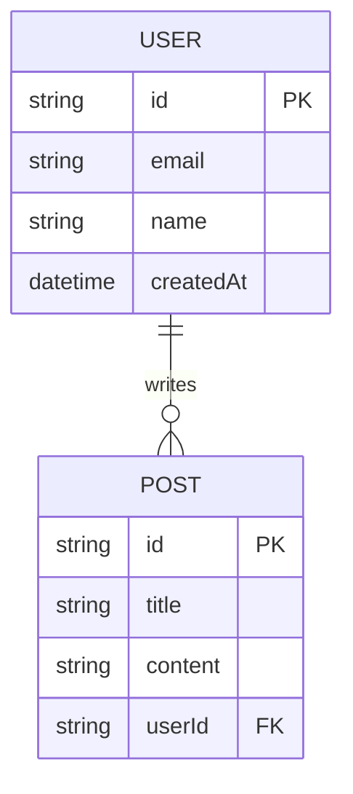

# DATABASE.md - Schéma de Base de Données

> ⚠️ **Exemple du template** : contenu illustratif, à remplacer par la spécification réelle (skill `project-bootstrap`). Ne pas le considérer comme une source de vérité.

## 🗄️ Modèles & Entités

